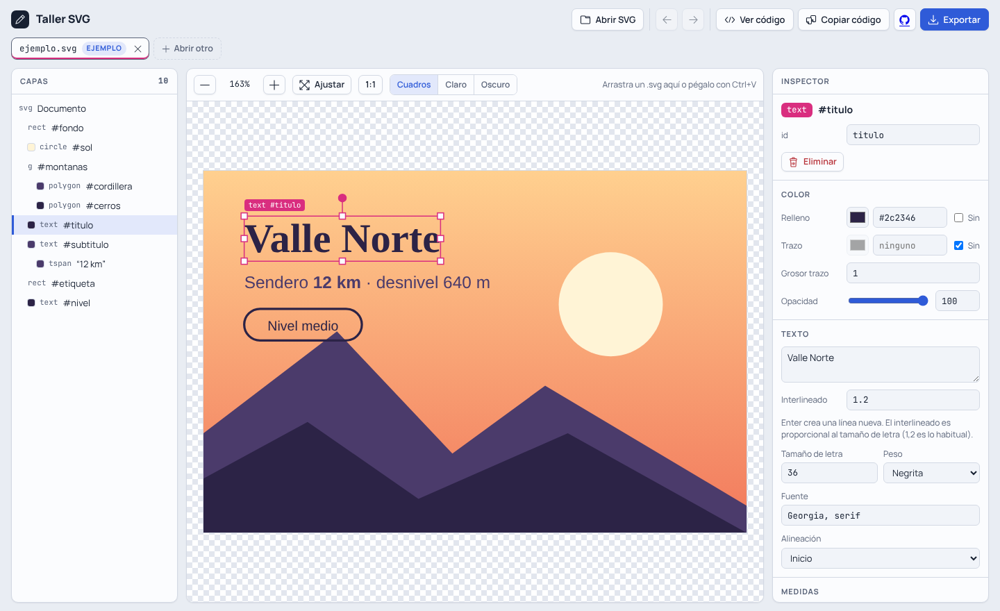

# Taller SVG

Editor de archivos SVG que funciona completo en el navegador. Abre un `.svg`, haz clic en cualquier elemento y cambia sus colores, textos y tamaños; mueve, escala y rota con el mouse, y exporta el resultado a SVG, PNG, JPG, WebP o PDF.

**Pruébalo:** https://javicortesc.github.io/svg-editor/



## Qué puedes hacer

- **Abrir varios archivos en pestañas.** Abre, arrastra o pega (Ctrl+V) uno o varios SVG. Cada pestaña guarda su propio historial de deshacer, zoom y selección.
- **Seleccionar elementos** haciendo clic en el lienzo o en el panel de capas, que muestra la estructura del archivo.
- **Editar colores:** relleno, trazo, grosor, opacidad y las paradas de los degradados. La paleta del documento reemplaza un color en todos los elementos que lo usan.
- **Editar textos:** contenido, tamaño, fuente, peso, alineación y saltos de línea con interlineado ajustable.
- **Mover, escalar y rotar con el mouse** usando el marco de selección, o con valores exactos en el inspector.
- **Reemplazar letras convertidas en trazos** por un texto editable del mismo color, en la misma posición.
- **Exportar** a SVG, PNG, JPG, WebP o PDF, eligiendo escala (1× a 4× o un ancho exacto), fondo transparente o de color, y calidad.

Los archivos abiertos se guardan en el navegador (`localStorage`) y se reabren la próxima vez. Nada se envía a ningún servidor.

## Atajos

| Acción | Atajo |
| --- | --- |
| Deshacer / Rehacer | Ctrl+Z / Ctrl+Shift+Z (o Ctrl+Y) |
| Mover el elemento seleccionado | Flechas (Shift: de a 10) |
| Eliminar el elemento seleccionado | Supr o Retroceso |
| Quitar la selección / cerrar diálogos | Esc |
| Mover solo en horizontal o vertical | Shift mientras arrastras |
| Girar de 15° en 15° | Shift mientras rotas |
| Invertir "mantener proporción" | Shift en una esquina |
| Editar un texto | Doble clic sobre él |
| Pegar un SVG como archivo nuevo | Ctrl+V fuera de los campos |

## Cómo está hecho

Es un único archivo, [`index.html`](index.html), con HTML, CSS y JavaScript sin frameworks ni paso de compilación.

- Los SVG se abren con `DOMParser` y se limpian antes de mostrarse: se eliminan los `<script>`, los atributos `on*` y los enlaces `javascript:`.
- Mover, escalar y rotar se guardan como un `transform` sobre el elemento, calculado con `DOMMatrix` en el sistema de coordenadas de su contenedor. Así funciona con cualquier forma, incluidos trazados y grupos.
- Los textos de varias líneas se escriben como un `<tspan>` por línea con posición propia, porque SVG no hace saltos de línea automáticos.
- La exportación a imagen dibuja el SVG en un `<canvas>`. El PDF se arma con [jsPDF](https://github.com/parallax/jsPDF), que se carga solo cuando eliges ese formato.
- Íconos de [LineIcons](https://lineicons.com) y tipografías Manrope y JetBrains Mono de Google Fonts.

### Usarlo en tu computador

Descarga el repositorio y abre `index.html` en el navegador. También puedes servirlo con cualquier servidor estático:

```bash
python3 -m http.server 8000
# luego abre http://localhost:8000
```

## Limitaciones conocidas

- Al exportar a imagen, el navegador solo usa las fuentes instaladas en tu equipo. Si el SVG usa otra, se reemplaza por una parecida.
- Las imágenes enlazadas desde otros sitios (`<image href="https://...">`) no aparecen en la exportación a PNG, JPG, WebP o PDF.
- Las letras convertidas en trazos no se pueden leer como texto. Se reemplazan escribiendo de nuevo las palabras.

## Licencia

[MIT](LICENSE) © 2026 Javier Cortés
